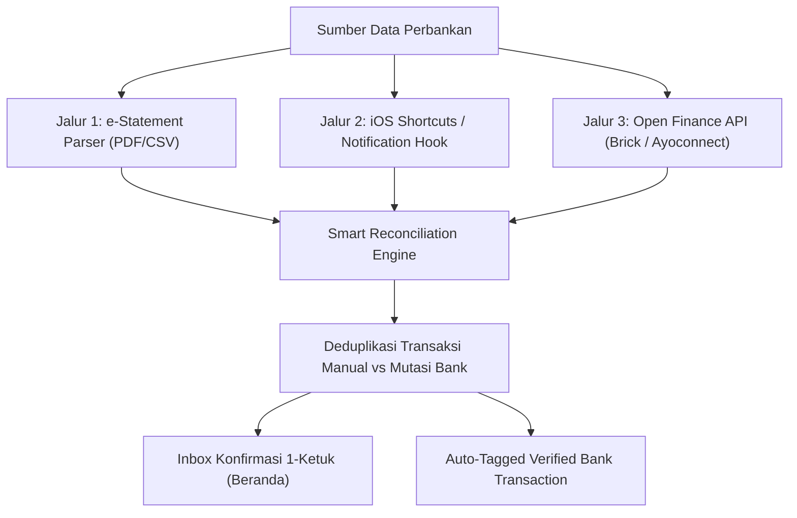

# Arsitektur & Spesifikasi Fitur: Pocketing (Kantong) & Integrasi Bank/Wallet

Dokumen ini berisi hasil persiapan teknis, *brainstorming*, dan spesifikasi arsitektur untuk pengembangan dua fitur strategis aplikasi UangKu:
1. **Fitur Pocketing (Kantong Keuangan)**
2. **Fitur Link to Bank & E-Wallet Account (Smart Reconciliation)**

---

## 1. Fitur Pocketing (Kantong Keuangan)

### 1.1 Konsep & Nilai Produk
Pocketing mengadopsi prinsip *envelope budgeting* modern (serupa fitur Kantong pada Bank Jago atau Jenius Saver), di mana saldo riil dari satu akun keuangan (cth: Rekening BCA) dibagi ke dalam sub-kantong virtual untuk mengontrol tujuan belanja dan mencegah pemakaian dana penting.

```text
Struktur Akun & Kantong:
Rekening BCA Utama (Total Saldo: Rp 10.000.000)
├── [Saldo Utama / Unallocated]   : Rp 4.000.000 (Bebas pakai)
├── [Kantong Belanja & Kuliner]   : Rp 3.000.000 (Spending Pocket)
├── [Kantong Tagihan & Cicilan]   : Rp 2.000.000 (Bills Pocket - Auto recurring)
└── [Kantong Dana Darurat]        : Rp 1.000.000 (Locked / Saving Pocket)
```

### 1.2 Tipe-Tipe Kantong
* **Spending Pocket (Kantong Bayar):** Untuk pengeluaran operasional sehari-hari. Terhubung langsung sebagai opsi sumber dana saat pencatatan transaksi cepat ($\le 10$ detik).
* **Locked / Saving Pocket (Kantong Terkunci):** Mengamankan uang dari godaan belanja impulsif. Tidak muncul sebagai opsi pembayaran transaksi harian kecuali dicairkan ke saldo utama.
* **Bills Pocket (Kantong Tagihan):** Khusus dialokasikan untuk mendanai transaksi berulang (*recurring rules* seperti langganan dan tagihan bulanan).

### 1.3 Skema Database (SQLite Lokal & Drizzle Backend)

```sql
CREATE TABLE IF NOT EXISTS local_pockets (
  id TEXT PRIMARY KEY,
  user_id TEXT NOT NULL,
  account_id TEXT NOT NULL REFERENCES local_accounts(id) ON DELETE CASCADE,
  name TEXT NOT NULL,
  emoji TEXT,
  type TEXT NOT NULL CHECK (type IN ('spending', 'saving', 'locked', 'bills')),
  allocated_balance INTEGER NOT NULL DEFAULT 0, -- Minor units (Rp)
  target_amount INTEGER,                        -- Target nominal opsional (minor units)
  is_locked INTEGER NOT NULL DEFAULT 0,
  sort_order INTEGER NOT NULL DEFAULT 0,
  created_at TEXT NOT NULL,
  updated_at TEXT NOT NULL
);

-- Penambahan relasi pada transaksi lokal:
ALTER TABLE local_transactions ADD COLUMN pocket_id TEXT REFERENCES local_pockets(id);
```

### 1.4 Aturan Konsistensi Saldo (Invariant)
$$\text{Total Saldo Akun} = \text{Saldo Unallocated} + \sum (\text{Saldo Seluruh Kantong})$$
* Mutasi alokasi antar kantong dalam akun yang sama (**Intra-Account Relocation**) tidak membuat transaksi pemasukan/pengeluaran baru, melainkan hanya memperbarui nilai `allocated_balance`.
* **Kebijakan Overspending:** Jika nominal transaksi pengeluaran melebihi sisa alokasi kantong belanja, aplikasi menampilkan konfirmasi untuk mengambil selisihnya dari saldo utama (*unallocated*).

---

## 2. Fitur Link to Bank & E-Wallet Account

### 2.1 Jalur Integrasi Teknis



1. **Jalur 1: e-Statement Parser (Offline-First & Zero Credential - Tahap 1)**
   * Pengguna mengunggah e-statement berkala (BCA, Mandiri, GoPay, OVO).
   * Parsing tabel mutasi dieksekusi secara privat.
   * **Keunggulan:** Bebas biaya API, 100% aman tanpa meminta password/PIN perbankan.

2. **Jalur 2: iOS Siri Shortcuts & Notification Hook (Semi-Otomatis - Tahap 2)**
   * Menangkap notifikasi pembayaran QRIS atau debit m-banking di iOS melalui otomasi *Apple Shortcuts*.
   * Mengirim payload ringkas ke UangKu melalui URL Scheme lokal.

3. **Jalur 3: Open Finance Aggregator (Live Sync - Tahap 3)**
   * Menghubungkan API pihak ketiga berizin (Brick/Ayoconnect) untuk sinkronisasi mutasi otomatis terjadwal di backend.

### 2.2 Mesin Rekonsiliasi Cerdas (*Smart Reconciliation Engine*)
Mencegah masalah **pencatatan ganda (*double-counting*)** antara transaksi manual pengguna dengan mutasi bank:
* **Deteksi Heuristik:** Membandingkan kesamaan tanggal ($\pm 24$ jam), nominal persis sama (`amount`), dan akun asal yang sama.
* **Tindakan Otomatis:**
  * Skor kecocokan $\ge 90\%$: Tautkan mutasi ke transaksi manual yang sudah ada (`matched_transaction_id`) dan sematkan badge `✓ Terverifikasi Mutasi Bank`.
  * Transaksi belum pernah dicatat: Muncul di kartu **Inbox Rekonsiliasi** di Beranda untuk dicatat menjadi transaksi baru dengan 1 ketukan.

### 2.3 Kepatuhan Keamanan & Apple App Store
* **Zero Credential Storage:** Tidak ada PIN ATM, kata sandi m-banking, atau token OTP yang disimpan di server UangKu.
* **Apple Guideline 5.1.1(v):** Seluruh data koneksi bank dan mutasi dapat dihapus tuntas secara mandiri oleh pengguna melalui fitur *Hapus Akun* (*cascading purge*).
* **Data Masking:** Nomor rekening perbankan disamarkan (cth: `BCA •••• 4892`).

---

## 3. Status Implementasi Fitur

| Fase / Fitur | Target Deliverable | Status |
| :--- | :--- | :--- |
| **Pocketing (Kantong)** | Skema `pockets`, layar manajemen kantong, transfer alokasi intra-akun, progress bar target, selector kantong di modal transaksi, dan badge kantong di riwayat transaksi. | **Selesai (100%)** |
| **Import e-Statement** | Tautkan rekening bank/e-wallet, parser mutasi CSV (BCA, Mandiri, BRI, GoPay), masking rekening (`•••• 4892`), dan pemutusan koneksi bank. | **Selesai (100%)** |
| **Smart Reconciliation** | Heuristic matching algorithm ($\pm 24$ jam & nominal exact), kartu Inbox Rekonsiliasi pada Beranda, modal dialog tautkan ke transaksi kandidat, aksi 1-ketuk catat baru/abaikan, dan badge `✓ Bank`. | **Selesai (100%)** |
| **Data Integrity & Security** | Outbox sync compatibility, auto-deduct/restore saldo kantong saat transaksi dibuat/dihapus, dan Apple Guideline 5.1.1(v) cascading deletion. | **Selesai (100%)** |
